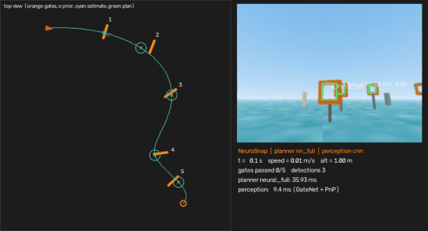
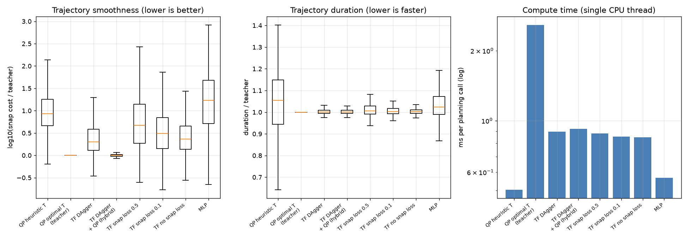
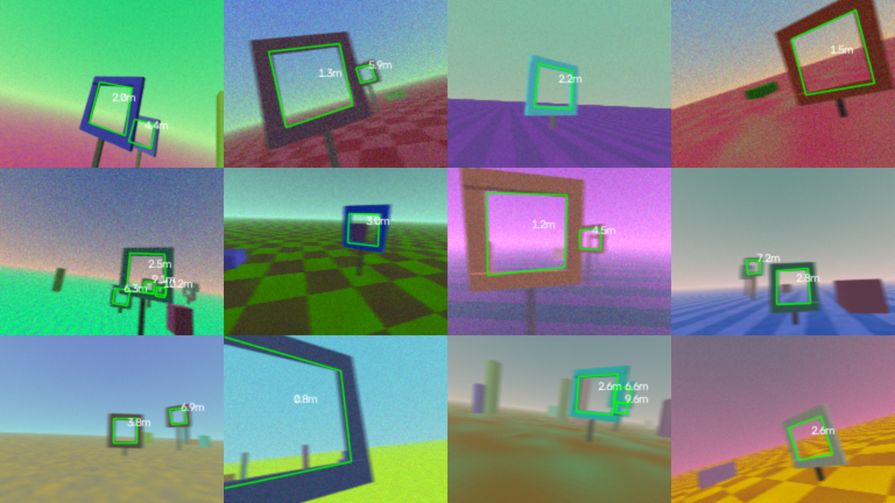
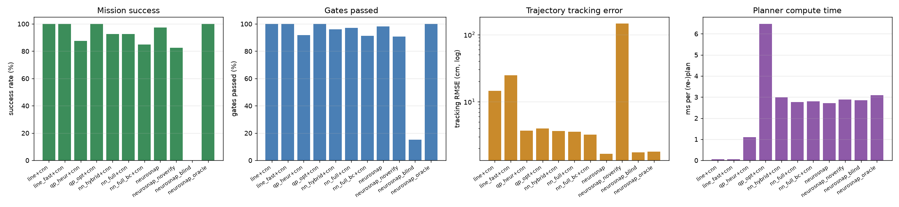
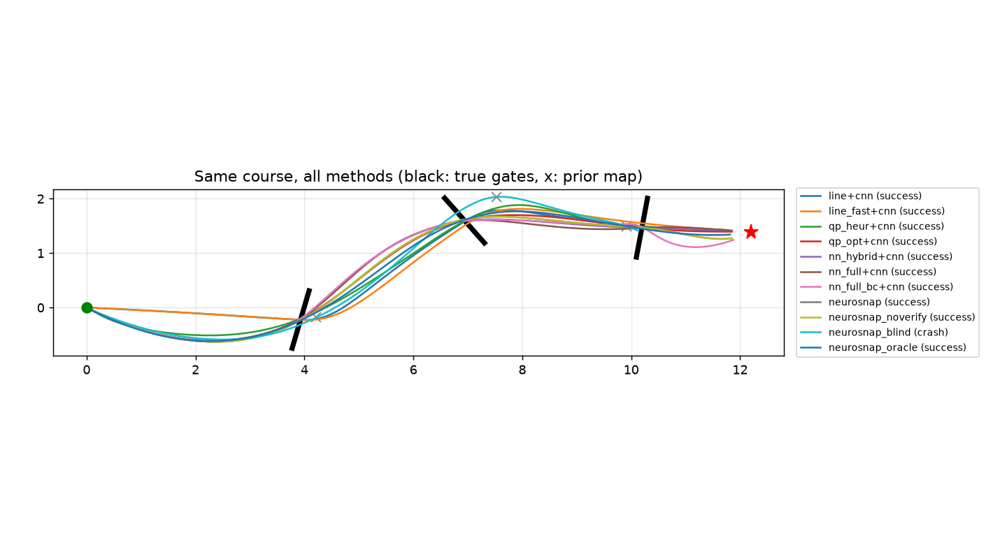
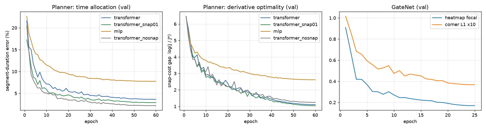
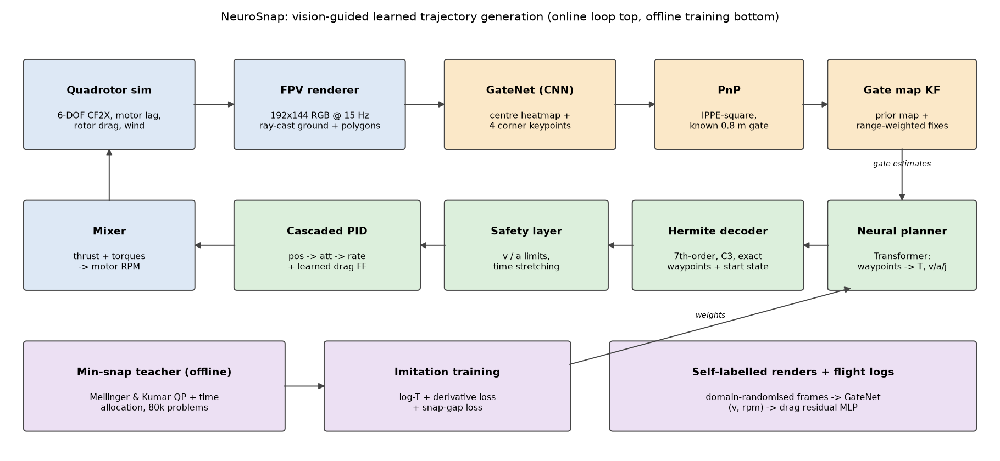

# NeuroSnap

**Vision guided learned trajectory generation for autonomous quadrotor gate navigation:
replacing minimum-snap optimisation with a deep-learning pipeline.**

Reference paper: D. Mellinger and V. Kumar, *"Minimum Snap Trajectory Generation and Control for
Quadrotors"*, IEEE ICRA 2011, pp. 2520–2525, [doi:10.1109/ICRA.2011.5980409](https://doi.org/10.1109/ICRA.2011.5980409).



A simulated Crazyflie-class quadrotor flies a randomised course of gates. It has only a forward
camera and an approximate (noisy) track map. Each frame goes through these stages:

1. **GateNet**, a small CNN, detects gates and their four opening corners.
2. **PnP**, using the known gate size, turns each detection into a 3-D gate position.
3. A **Kalman-filter gate map** fuses those fixes with the prior map.
4. A **Transformer trajectory generator** turns the remaining gates and the current state into a
   smooth trajectory in one forward pass.
5. A **cascaded PID** with a **learned drag model** flies the trajectory.

The paper's run-time mathematics (differential-flatness QP and time-allocation optimisation)
is used only *offline*, as the teacher that labels training data and as the baseline the
network is compared against.

---

## Core ideas

* **Same trajectory family as the paper, predicted by a network.** A trajectory is a set of 7th-order
  polynomial segments defined by position, velocity, acceleration and jerk at every waypoint. The network
  predicts the segment durations and the free knot derivatives. A fixed, differentiable Hermite decoder
  turns these into polynomials. So *every* network output passes exactly through the waypoints,
  starts from the current state and is C3-continuous, by construction. The network only has to get the
  *shape* right.
* **DAgger for receding-horizon re-planning.** Training on teacher trajectories alone (behaviour cloning)
  is not enough. In flight the network re-plans every 0.1 s from states on its *own* previous plan, small
  duration biases compound, and the drone keeps slowing down: flight time drifts to 1.90× the first plan
  (teacher: 1.25×). Three DAgger rounds fix much of this. Each round rolls out the network, labels the
  ~25k states it visits with the teacher and fine-tunes. Drift drops to 1.44×, and closed-loop success
  rises from 85% to 92.5%.
* **Analytic plan verifier.** Before a learned (or classical) re-plan replaces the current trajectory, it
  must not reverse direction on its first segment and must not reach the next gate much later than the
  current plan. Otherwise the current plan is kept. This cheap certificate turns rare network failures
  into "skip one re-plan". Without it the full stack drops from 97.5% to 82.5% success.
* **Receding-horizon training data.** Half of the 80k teacher problems start mid-flight from a teacher
  trajectory with perturbed velocity/acceleration, so the network sees re-planning states from the start.
* **Corners + PnP instead of a black-box pose regressor.** GateNet is CenterNet-style: a centre heatmap
  plus 8 corner offsets. `cv2.SOLVEPNP_IPPE_SQUARE` with the known 0.8 m opening gives the full gate pose,
  so the geometry stays exact and only the keypoints are learned.
* **Self-labelled, domain-randomised data.** A small numpy/OpenCV renderer (ray-cast textured ground,
  flat-shaded polygon gates and distractors, fog, noise, motion blur) outputs exact corner labels for every
  frame. GateNet trains on an infinite stream of fresh renders.
* **Learned residual dynamics.** A 4→32→32→3 MLP learns the rotor drag the PID does not model, from
  logged flights, and cancels it as feed-forward.

## Results

All numbers come from the scripts below, run on an Apple M1 (8 GB). JSON/CSV versions are in `results/`.

### 1. Learned planner vs. the paper's optimiser (1000 held-out re-planning problems)

Snap cost and duration are relative to the minimum-snap teacher with optimised time allocation
(Mellinger & Kumar). Timings are single CPU thread, including the safety layer.

| Planner | snap / optimal (median) | snap p90 | duration / optimal (median) | ms per call (mean / p95) |
|---|---|---|---|---|
| Min-snap QP, heuristic time allocation | 8.59× | 66.2× | 1.054 | 0.50 / 1.00 |
| Min-snap QP, optimised time allocation (teacher) | 1.00× | 1.00× | 1.000 | 2.58 / 4.19 |
| **Transformer + DAgger, full neural (no solver)** | **2.01×** | 9.1× | **1.001** | **0.90 / 1.23** |
| **Transformer + DAgger, hybrid (neural T + one closed-form QP)** | **1.00×** | **1.09×** | **1.001** | **0.92 / 1.17** |
| Transformer, behaviour cloning only | 2.31× | 11.2× | 1.002 | 0.85 / 1.16 |
| Transformer, + snap-gap loss 0.1 | 3.10× | 19.4× | 1.002 | 0.85 / 1.17 |
| Transformer, + snap-gap loss 0.5 | 4.68× | 38.3× | 1.005 | 0.88 / 1.24 |
| MLP (same outputs, snap loss 0.5) | 17.0× | 124× | 1.023 | 0.57 / 0.90 |

* **Hybrid mode matches the teacher at about 2.8× lower cost** (mean 0.92 vs 2.58 ms; p95 1.17 vs
  4.19 ms). The network replaces the iterative time-allocation optimisation (median duration within
  0.1% of optimal) and one linear solve recovers the optimal derivatives.
* **Full-neural mode needs no solver at all.** Its durations are still near-optimal, but its trajectories
  carry about 2× the minimum snap, because snap is very sensitive to jerk errors at the knots.
* **Attention matters.** The MLP with the same output layer is 8× worse in snap.
* **Negative result: the snap-gap loss does not help end to end.** It lowers snap at the teacher's
  durations (validation gap 1.05 vs 1.25), but it makes the predicted durations less accurate.
  Snap scales with T⁻⁷, so in the full pipeline duration accuracy dominates and plain imitation wins.



### 2. DAgger removes most of the receding-horizon slow-down

Planner-only rollouts on 100 unseen courses, re-planning every 0.1 s from the reference state
(`scripts/dagger_planner.py`). The drift ratio is the time to finish divided by the duration of the first plan.

| Planner | drift (median) | drift (p90) | rollouts that blow up (>3×) |
|---|---|---|---|
| Teacher (min-snap, optimised T) | 1.25 | 1.60 | 0 |
| Transformer, behaviour cloning | 1.90 | 2.46 | 8 |
| + DAgger round 1 (24k states) | 1.62 | 2.00 | 3 |
| + DAgger round 2 (25k states) | 1.49 | 1.79 | 5 |
| **+ DAgger round 3 (25k states, deployed)** | **1.44** | **1.78** | **2** |

### 3. Perception (1000 held-out randomised frames)

GateNet trained on 200k freshly rendered frames (about 35 min on the M1 GPU). Scored on gates within 8 m.

| Metric | Value |
|---|---|
| Precision / recall | 0.89 / 0.89 |
| Corner keypoint error (median) | 1.19 px |
| Gate-centre error after PnP, 0–2 m / 2–4 m / 4–6 m / 6–8 m (median) | 4.8 / 7.3 / 17.6 / 34.3 cm |
| Latency, GateNet + decoding + PnP, CPU | 8.7 ms mean, 12.8 ms p95 (budget 66 ms at 15 Hz) |



### 4. Learned residual dynamics

The drag MLP explains **86%** of the unmodelled acceleration (0.234 → 0.034 m/s² RMS on held-out flights).
In closed loop it cuts tracking error from 3.6 cm to 1.7 cm (rows `nn_full+cnn` vs `neurosnap` below).

### 5. Closed-loop benchmark (440 missions: 40 unseen courses × 11 methods)

3–7 gates per course (0.8 m opening), a prior map with σ = 0.45 m position noise, random wind, and a
camera at 15 Hz. Every method flies the same courses, prior maps and wind.

| Method | Success | Crash | Missed gate | Gates passed | Lap (s) | Tracking RMSE (cm) | Gate est. error (cm) | Plan (ms) |
|---|---|---|---|---|---|---|---|---|
| Straight line, 2.2 m/s + GateNet | 100% | 0% | 0% | 100% | 9.4 | 14.5 | 2.8 | 0.05 |
| Straight line, 3.0 m/s + GateNet | 100% | 0% | 0% | 100% | 7.0 | 24.7 | 3.7 | 0.06 |
| Min-snap, heuristic T + GateNet | 87.5% | 5% | 7.5% | 91.9% | 13.5 | 3.7 | 7.7 | 1.11 |
| Min-snap, optimised T + GateNet (paper) | 100% | 0% | 0% | 100% | 13.6 | 4.0 | 4.0 | 6.47 |
| Neural hybrid + GateNet | 92.5% | 5% | 2.5% | 96.0% | 15.0 | 3.7 | 6.8 | 2.99 |
| Neural full + GateNet | 92.5% | 5% | 2.5% | 97.2% | 14.9 | 3.6 | 4.4 | 2.76 |
| Neural full, no DAgger + GateNet | 85.0% | 10% | 2.5% | 91.3% | 16.8 | 3.2 | 5.7 | 2.80 |
| **NeuroSnap (neural full + GateNet + residual)** | **97.5%** | 2.5% | 0% | 98.1% | 15.2 | **1.7** | 3.5 | 2.72 |
| NeuroSnap without plan verifier | 82.5% | 7.5% | 7.5% | 90.7% | 16.3 | 145.7* | 4.1 | 2.89 |
| NeuroSnap, blind (prior map only) | 0% | 62.5% | 37.5% | 15.1% | – | 1.8 | 49.2 | 2.86 |
| NeuroSnap, oracle gates (upper bound) | 100% | 0% | 0% | 100% | 10.6 | 1.8 | 0.0 | 3.09 |

\* One run diverged after accepting a bad plan, which dominates the mean.
Planner times here are inflated because 7 missions ran in parallel; see table 1 for single-thread timings.

How to read this honestly:

* **Perception is what makes the task solvable.** On the prior map alone, 0% of courses are
  completed. With GateNet + PnP + the Kalman map, gate-position error falls from 49 cm to 3.5 cm and
  NeuroSnap completes 97.5% of courses.
* **The learned stack reaches the classical planner's reliability within 2.5 points** (97.5% vs 100%),
  with 2.4× lower tracking error (thanks to the residual model) and no optimiser on board.
* **It is still about 11% slower per lap than the classical planner** (15.2 vs 13.6 s). This is the
  remaining receding-horizon drift (1.44× vs 1.25× for the teacher). Without re-planning (oracle) the
  same network flies the course in 10.6 s.
* **DAgger and the verifier are both needed.** Removing DAgger costs 7.5 points of success; removing
  the verifier costs 15.
* **The straight-line follower is a strong baseline here.** The 0.8 m gates are generous for a 12 cm
  vehicle and lines go straight through the gate centres, so it never fails. The price is 4–15× larger
  tracking error (14.5–24.7 cm). This is exactly the dynamic infeasibility that minimum-snap planning
  exists to remove, and it would fail with tighter gates or faster flight.





## Architecture



| Module | File | What it does |
|---|---|---|
| Quadrotor | `neurosnap/sim/quadrotor.py` | 6-DOF Newton-Euler, Crazyflie CF2X parameters (gym-pybullet-drones), motor lag, rotor drag, wind, 1 kHz |
| Controller | `neurosnap/sim/controller.py` | position/velocity PID with acceleration feed-forward → SO(3) attitude P → body-rate PI → mixer, 500 Hz |
| Residual model | `neurosnap/sim/residual.py` | learned drag feed-forward (numpy inference) |
| Course | `neurosnap/world/course.py` | random gate courses, noisy prior map, gate pass / crash classification |
| Renderer | `neurosnap/vision/renderer.py` | FPV camera, 192×144, 90° HFOV, tilted 15° up, domain randomisation, exact labels |
| GateNet | `neurosnap/perception/net.py`, `detector.py` | 2.9M-param CNN, centre heatmap + corners, PnP pose |
| Gate map | `neurosnap/perception/gatemap.py` | per-gate Kalman filter, Mahalanobis association, range-dependent noise |
| Polynomials | `neurosnap/traj/poly.py` | knot-derivative parametrisation, closed-form snap Gram matrix, limit enforcement |
| Teacher | `neurosnap/traj/minsnap.py` | min-snap QP (closed form) + time allocation with envelope-theorem gradients |
| Neural planner | `neurosnap/planning/neural.py` | Transformer / MLP encoders, Hermite decoder, snap cost in torch |
| DAgger | `neurosnap/traj/dagger.py` | receding-horizon rollouts, teacher relabelling |
| Mission | `neurosnap/mission.py` | closed-loop perception → map → re-plan → verify → control → events |
| Dashboard | `neurosnap/viz/dashboard.py` | top view + FPV + HUD, live or recorded |

## Quick start

```bash
python3.12 -m venv .venv
.venv/bin/pip install -r requirements.txt
.venv/bin/python scripts/demo.py --seed 3 --live          # live dashboard window (Esc to quit)
```

The trained weights are in `models/`. Other demo options are `--planner qp_opt|qp_heur|line|nn_hybrid`,
`--perception blind|oracle` and `--no-residual`. `--save out.mp4` / `--gif out.gif` record the run.


## Limitations

* **Simulation only.** The physics, camera and gates are synthetic. The renderer is far simpler than a
  real camera (no lens distortion, rolling shutter or real textures), so a real-world GateNet would need
  fine-tuning on real images.
* **Generous gates.** The 0.8 m opening for a 12 cm drone makes the task forgiving, which is why the
  straight-line baseline succeeds. Smaller gates or higher speed limits would separate the planners more.
* **Remaining drift.** After DAgger, receding-horizon re-planning is still slower than the teacher
  (1.44× vs 1.25×). More DAgger rounds or a consistency loss between consecutive plans are the next steps.
* **The verifier is a heuristic.** It catches overshoot loops and sudden slow-downs, not every bad plan
  (one 2.5% crash remains).
* **No obstacle avoidance.** Distractor objects are only visual; the planner flies gate to gate.
* **Yaw is not planned.** The heading simply points at the next gate. The paper also plans yaw.
* **State estimation is idealised.** Position and velocity come from the simulator plus small Gaussian
  noise; there is no VIO.
